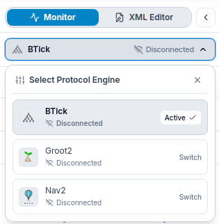

===================
System Architecture
===================

BTick separates robot-level behavioral communication from client-side UI delivery through a unified bridge architecture.

System Overview
===============

The bridge layer acts as a multiplexer and normalization engine, abstracting the differences between robot communication protocols so the graphical interface receives consistent data:

.. raw:: html

   

.. code-block:: text

    +---------------------------------------------------------------------------------------+
    |                               Robot / Application                                     |
    |                                                                                       |
    |       BTick                               Nav2                       Groot2           |
    |  btick::Monitor                     /behavior_tree_log           Groot2Publisher      |
    +---------------------------------------------------------------------------------------+
                |                                 |                             |
          ROS 2 Topics                       ROS 2 Topic                  TCP / ZMQ
            (/btick/*)                   (/behavior_tree_log)             (1667 / 1668)
                |                                 |                             |
                +---------------------------------+-----------------------------+
                                                  |
    +---------------------------------------------------------------------------------------+
    |                         BTick Unified Multi-Protocol Bridge                           |
    |                                                                                       |
    |       btick_bridge.py              nav2_bridge.py             groot2_bridge.py        |
    +---------------------------------------------------------------------------------------+
                                                  |
                          +------------------------+------------------------+
                          |                                                 |
                Web Application Path                              Desktop Application Path
                          |                                                 |
                +----------------------+                         +----------------------+
                | WebSocket Server     |                         | Electron Desktop     |
                | Port 8080            |                         | Application          |
                |                      |                         |                      |
                | HTTP Server          |                         | React + ReactFlow    |
                | Port 3000            |                         |                      |
                +----------------------+                         +----------------------+
                          |                                                 |
                +----------------------+                         +----------------------+
                | Browser              |                         | Native Linux .deb    |
                | React + ReactFlow    |                         |                      |
                | localhost:3000       |                         |                      |
                +----------------------+                         +----------------------+

Components
==========

.. list-table::
   :widths: 20 27 56
   :header-rows: 1

   * - Component
     - Implementation / Location
     - Responsibilities
   * - **C++ Client Library**
     - ``btick`` (ROS 2 package)
     - Instruments BehaviorTree.CPP v4 applications via ``btick::Monitor``, publishing tree topology and runtime transitions while handling remote execution and debugging commands over ROS 2 topics.
   * - **Unified Bridge Server**
     - ``bridge/bt_bridge.py``
     - Coordinates protocol bridges, normalizes tree telemetry into a unified WebSocket stream (port 8080), routes client commands, and serves the web application over HTTP (port 3000).
   * - **BTick Bridge**
     - ``bridge/btick_bridge.py``
     - Connects to the C++ client over ROS 2 topics, streaming live tree discovery and transition events while forwarding interactive debugging commands to instrumented trees.
   * - **Nav2 Bridge**
     - ``bridge/nav2_bridge.py``
     - Provides passive, read-only monitoring by subscribing to Nav2's native ``/behavior_tree_log`` topic, matching navigation events against loaded XML trees without accepting commands.
   * - **Groot2 ZMQ Bridge**
     - ``bridge/groot2_bridge.py``
     - Connects to BehaviorTree.CPP's ``BT::Groot2Publisher`` via ZMQ REQ (port 1667) and SUB (port 1668) sockets, retrieving tree structures, polling statuses, and managing breakpoint hooks.
   * - **Visualizer & Editor**
     - ``src/`` (React + ReactFlow)
     - Web and desktop frontend providing real-time tree canvas visualization, interactive execution controls where supported, visual XML tree editing, and session recording and replay.

Robot Communication Protocols
=============================

1. **BTick**

   Integrates BehaviorTree.CPP applications with BTick through ROS 2 topics. It publishes tree discovery and transition telemetry and runs an auxiliary node (``btick_cmd_<NodeName>_<TreeId>``) on a dedicated executor. It supports interactive debugging commands, including breakpoint-based pausing, stepping, forced status, delay injection, Blackboard writes, and live port editing. Commands are routed by ``tree_id``.

2. **Nav2**

   Passively monitors Nav2 through the ``/behavior_tree_log`` topic using ``nav2_msgs/msg/BehaviorTreeLog``. The bridge matches log events against user-loaded XML trees and normalizes node statuses. It is read-only and does not provide command execution or Blackboard telemetry.

3. **Groot2**

   Connects to ``BT::Groot2Publisher`` through ZMQ REQ and SUB sockets, using default ports ``1667`` and ``1668``, respectively. It supports tree and status retrieval, read-only Blackboard inspection, supported debugging controls, and transition monitoring. Blackboard writes, port editing, and delay injection are not supported.

For a detailed side-by-side comparison of protocol capabilities, see :doc:`protocol_comparison`.

Internal Web Transports
=======================

The bridge communicates with the frontend using two internal web transports:

* **WebSocket Server (Default Port: 8080)**:
  Implemented in ``bridge/common.py`` (pure-Python RFC 6455 implementation). Streams standardized JSON state events to connected clients and handles UI commands. Configurable via the ``--ws-port`` CLI flag or the ``WS_PORT`` environment variable.
* **HTTP SPA Server (Default Port: 3000)**:
  Serves compiled React frontend static files. Configurable via the ``--http-port`` CLI flag or the ``HTTP_PORT`` environment variable. The static asset distribution directory is configured via the ``--dist-dir`` CLI option (defaulting to the local ``dist/`` directory if present).

Groot2 Connection Settings
--------------------------

The Groot2 bridge connects to BehaviorTree.CPP's ``BT::Groot2Publisher`` via ZMQ REQ and SUB sockets:

* **Target Host**: Configurable via ``--zmq-host`` (environment: ``ZMQ_HOST``, default: ``127.0.0.1``). In standalone ``groot2_bridge.py``, configured via ``--host``.
* **REQ Socket Port**: Configurable via ``--zmq-port`` (environment: ``ZMQ_PORT``, default: ``1667``). In standalone ``groot2_bridge.py``, configured via ``--port``.
* **SUB Socket Port**: Derived automatically as ``port + 1`` (default: ``1668``) and connects to the same target host to subscribe to transitions and breakpoint notifications.

Common Event Model
==================

The bridge normalizes protocol data into JSON events and broadcasts them to frontend clients over WebSocket. Available events depend on the connected protocol.

* **tree_created / tree**: Publishes behavior tree topology and node definitions.
* **transition**: Reports node status transitions and associated metadata.
* **protocol_heartbeat / status**: Reports protocol connection and runtime status.
* **execution_cycle_started**: Signals the start of a root-node execution cycle (BTick and Groot2).
* **tree_status**: Resets tree state when a connection is lost or a stream times out (Nav2 and Groot2).
* **execution_resumed**: Signals resumed execution after a breakpoint is unlocked (Groot2).
* **blackboard_update**: Publishes Blackboard snapshots (Groot2).
* **blackboard_update_response**: Reports the result of a Blackboard write command (BTick).
* **set_node_port_response**: Reports the result of a node-port edit command (BTick).

Event payloads and available debugging features vary by protocol. Nav2 is read-only; it does not provide standalone Blackboard updates or live node-port editing.

Connection States
=================

Each protocol adapter tracks and broadcasts protocol liveness via heartbeat messages containing one of three standardized states:

* **CONNECTED_RUNNING**: The bridge is connected to the robot source and actively observing execution.
* **CONNECTED_IDLE**: The bridge is connected to the source, but the tree is currently idle or waiting for goals.
* **DISCONNECTED**: The source is unreachable or not publishing data.
