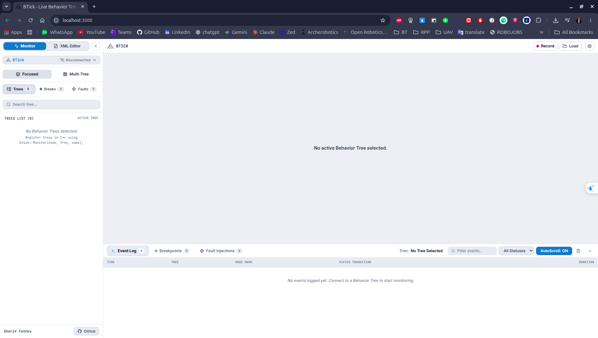
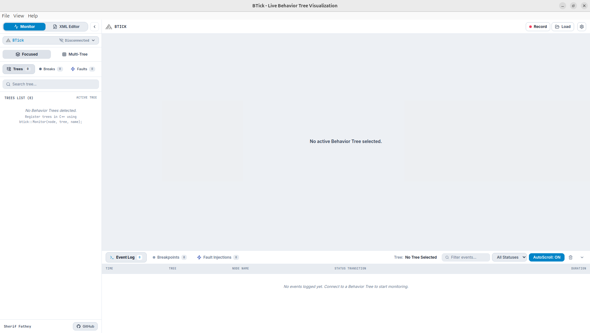

==============================
Installation & Getting Started
==============================

This guide covers installing BTick, launching the visualizer, configuring Docker Compose from scratch, and executing a verified first run.

Prerequisites
=============

* **Operating System**: Ubuntu 22.04 LTS (Jammy) or 24.04 LTS (Noble).
* **Deployment Options**:

  Choose the deployment option that best fits your development environment.

  .. list-table::
     :header-rows: 1
     :widths: 24 38 38

     * - Deployment
       - Description
       - Access
     * - **Docker Web Application**
       - Runs BTick in a containerized environment.
       - Access the interface through a web browser.
     * - **Native Linux Desktop**
       - Runs BTick as a desktop application packaged as a Linux ``.deb``.
       - Launch the installed desktop application.

* **Robot Stack (for live monitoring)**:

  * ROS 2 Humble, Iron, or Jazzy.
  * BehaviorTree.CPP v4.

Option A: Docker Compose Deployment
===================================

This option is recommended for users who want to run BTick in a containerized environment.

1. Creating the Docker Compose File
-----------------------------------

Create a dedicated directory and save the following ``docker-compose.yml``:

.. code-block:: bash

   mkdir -p ~/btick_deploy
   cd ~/btick_deploy
   nano docker-compose.yml

Paste the complete, verified configuration below:

.. code-block:: yaml

   # ==============================================================================
   # BTick Behavior Tree & ROS 2 Monitor Docker Compose
   # ==============================================================================
   services:
     btick:
       image: sheriffathey/btick:latest
       container_name: btick  
       network_mode: host
       restart: unless-stopped
       environment:
         - HTTP_PORT=${HTTP_PORT:-3000}
         - WS_PORT=${WS_PORT:-8080}
         - ZMQ_PORT=${ZMQ_PORT:-1667}
         - ZMQ_HOST=${ZMQ_HOST:-127.0.0.1}
         - ROS_DOMAIN_ID=${ROS_DOMAIN_ID:-0}
         - RMW_IMPLEMENTATION=${RMW_IMPLEMENTATION:-}
         - CYCLONEDDS_URI=${CYCLONEDDS_URI:-}
         - PYTHONUNBUFFERED=1

         # Automatic browser opening (set OPEN_BROWSER=false for headless robots)
         - OPEN_BROWSER=${OPEN_BROWSER:-true}
         - BROWSER=/usr/local/bin/xdg-open
         - DBUS_SESSION_BUS_ADDRESS=${DBUS_SESSION_BUS_ADDRESS:-}
         - XDG_RUNTIME_DIR=${XDG_RUNTIME_DIR:-}

       volumes:
         - /tmp:/tmp:ro
         - ${XDG_RUNTIME_DIR:-/run/user}:${XDG_RUNTIME_DIR:-/run/user}:ro

.. dropdown:: 2. Configuration Breakdown
   :class-container: config-dropdown

   **Docker Image**

   ``image: sheriffathey/btick:latest``

   Uses the BTick Docker image, which includes the web application and its communication bridges.

   **Network Configuration**

   ``network_mode: host``

   Uses the host network, allowing BTick to communicate with ROS 2 nodes and access services exposed on the host network. No Docker port mappings are required.

   **Endpoint Configuration**

   * **HTTP Web Interface:** Open ``http://localhost:3000`` on the host, or ``http://<robot-ip>:3000`` from another device. Configured through ``HTTP_PORT``.
   * **WebSocket Transport:** The browser connects to the bridge through ``ws://localhost:8080``, or ``ws://<robot-ip>:8080`` remotely. Configured through ``WS_PORT``.
   * **ZMQ:** The bridge connects to the Groot2 publisher at ``ZMQ_HOST:ZMQ_PORT``. The defaults are ``127.0.0.1:1667``.

   **ROS 2 Configuration**

   * ``ROS_DOMAIN_ID`` (default: ``0``): Must match the domain ID used by the ROS 2 nodes you want to monitor.
   * ``RMW_IMPLEMENTATION``: Optionally selects the ROS 2 middleware implementation, such as ``rmw_cyclonedds_cpp`` or ``rmw_fastrtps_cpp``. Leave empty to use the environment's default.
   * ``CYCLONEDDS_URI``: Optionally provides the Cyclone DDS configuration URI when using Cyclone DDS.

   **Browser Configuration**

   * ``OPEN_BROWSER`` (default: ``true``): Controls whether BTick attempts to open a browser on startup. Set it to ``false`` for headless robots or servers.
   * ``BROWSER``: Specifies the browser-launch command used by the container.
   * ``DBUS_SESSION_BUS_ADDRESS`` and ``XDG_RUNTIME_DIR``: Pass desktop-session settings used when launching a browser.

   **Volume Mounts**

   * ``/tmp:/tmp:ro``: Mounts the host's ``/tmp`` directory as read-only.
   * ``${XDG_RUNTIME_DIR:-/run/user}:${XDG_RUNTIME_DIR:-/run/user}:ro``: Mounts the configured runtime directory as read-only for desktop-session integration.

3. Starting and Stopping the Container
--------------------------------------

Start BTick in detached mode:

.. code-block:: bash

   cd ~/btick_deploy
   docker compose up -d

Stop BTick:

.. code-block:: bash

   docker compose down

View live bridge logs:

.. code-block:: bash

   docker compose logs -f btick

First Launch
-------------

Option B: Native Linux Desktop Package (.deb)
=============================================

For native desktop execution without Docker:

1. **Download the Package**:

   Open the `latest BTick release <https://github.com/SherifFathey/btick_app/releases/latest>`_.
   Under **Assets**, download the latest ``.deb`` package to your computer.

   You can also download the latest package from a terminal with:

   .. code-block:: bash

      wget "$(curl -s https://api.github.com/repos/SherifFathey/btick_app/releases/latest | grep "browser_download_url.*$(dpkg --print-architecture)\.deb" | cut -d '"' -f 4)"

2. **Install via apt**:

.. code-block:: bash

   sudo apt update
   sudo apt install ./btick_*.deb

3. **Launch the Application**:

.. code-block:: bash

   btick

First Launch
------------

Connect BTick to a supported behavior tree source to start monitoring its execution.

