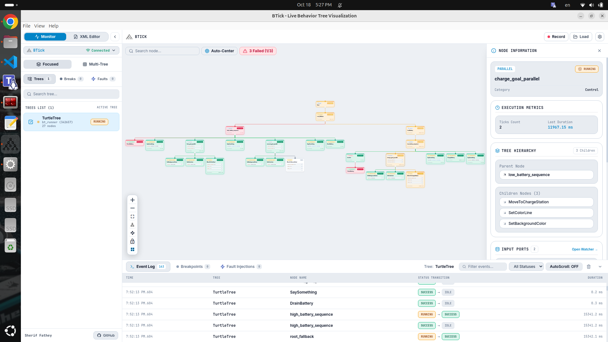

===========================================
BTick: Behavior Tree Visualizer & Debugger
===========================================

BTick is a real-time visualization, debugging, and authoring tool for
`BehaviorTree.CPP <https://github.com/BehaviorTree/BehaviorTree.CPP>`_ v4,
designed for robotics development and ROS 2 applications.

It provides a graphical interface for inspecting behavior tree execution,
understanding node states, debugging failures, and working with behavior tree
XML files. BTick can run as a Docker-based web application or as a native
Linux desktop application.

   Inspect behavior tree structure, execution flow, and node states in real time.

What is BTick?
==============

Behavior trees are widely used in autonomous robotics to coordinate tasks such
as mobile navigation, docking, manipulation, and recovery behaviors.

As behavior trees become more complex, understanding their runtime behavior
through terminal logs alone can be difficult. BTick provides a visual way to
inspect tree execution and investigate unexpected behavior.

Getting Started
===============

Ready to use BTick? Start with :doc:`getting_started` to set up your
environment and connect to a behavior tree.

Documentation Contents
======================

.. toctree::
   :maxdepth: 2
   :caption: Getting Started

   getting_started

.. toctree::
   :maxdepth: 2
   :caption: Concepts

   architecture
   protocol_comparison

.. toctree::
   :maxdepth: 2
   :caption: Application Guides

   monitor
   xml_editor

.. toctree::
   :maxdepth: 2
   :caption: Integrations

   btick_Integration