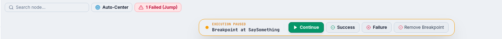
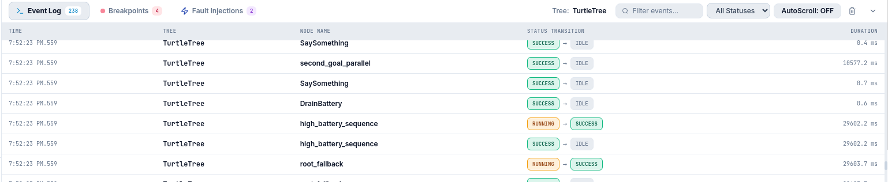
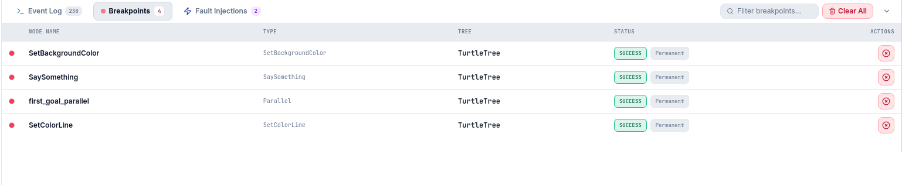
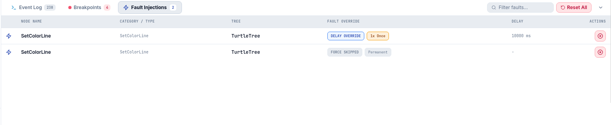
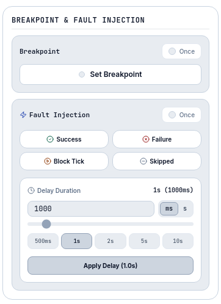
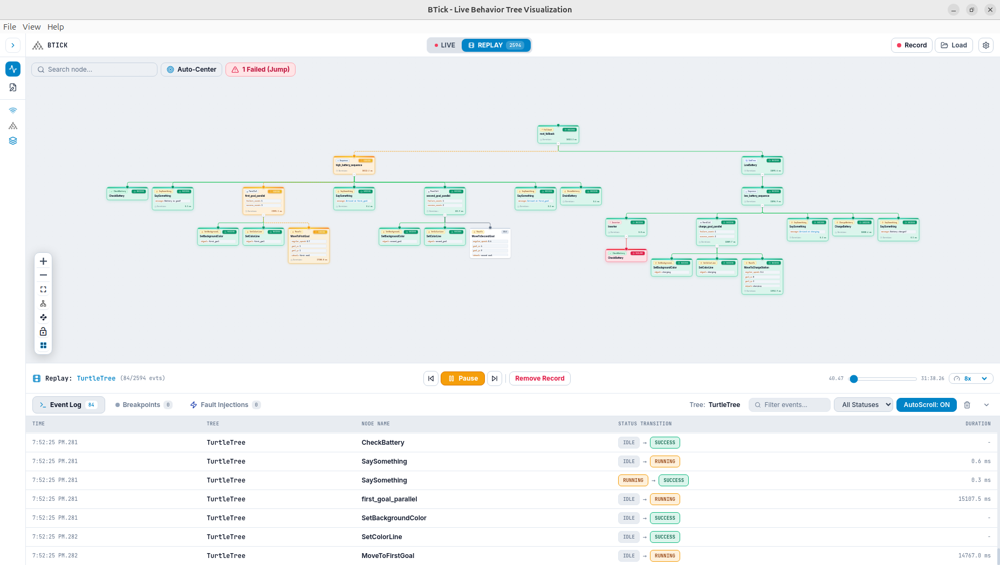

==================
Monitor User Guide
==================

The BTick Monitor interface provides real-time visualization, telemetry, and interactive debugging for BehaviorTree.CPP applications. It enables operators and developers to observe behavior tree execution, inspect runtime blackboard variables, trace failures, and test recovery behavior.

1. Overview
===========

Use the Monitor interface to:

* Observe live node transitions and behavior tree execution in real time.
* Inspect node metadata, execution durations, tick counts, and port bindings.
* Open the **Live Blackboard Watcher** to monitor shared variables and modify values.
* Debug trees interactively using breakpoints, forced statuses, and delay injection.
* Trace execution errors using event logs and jump directly to failing nodes.
* Record execution sessions to JSON files and replay them using a timeline scrubber.

2. Monitor Workspace
====================

The Monitor workspace consists of the following primary interface areas:

* **Header Bar**: Displays the application branding, session recording controls (**Record** / **Stop**, **Load**), and the **Settings** menu.

* **Left Sidebar**:

  * Mode switcher (**Monitor** and **XML Editor**).
  * Connection and protocol selector (**BTick**, **Groot2**, **Nav2**).
  * View mode toggle (**Focused** (single-tree view) vs. **Multi-Tree**).
  * Navigation tabs (**Trees**, **Breakpoints**, **Fault Injections**).
.. grid:: 2
   :gutter: 3

   .. grid-item::

      .. figure:: _static/images/left_sidebar.png
         :alt: Left sidebar showing mode switcher, protocol selector, view mode toggle, and navigation tabs
         :align: center

   .. grid-item::

      .. figure:: _static/images/Protocols.png
         :alt: BTick bridge architecture showing supported protocols and their capabilities
         :align: center

* **Behavior Tree Display Area**: The main interactive viewing area rendering the behavior tree graph, hierarchical node connections, and live execution status colors.

* **Display Area Controls & Overlays**:

  * **Top Search & Controls Overlay**: Includes the **Search node** input and **Auto-Center** control.
  * **Bottom-Left Display Area Controls**: Includes zoom, fit view, layout orientation, path style, display lock, and reset layout controls.

* **Breakpoint Banner**: When execution pauses at a breakpoint, a top banner displays the paused node name and action buttons: **Continue**, **Success**, **Failure**, and **Remove Breakpoint**.

* **Node Details Panel (Right Drawer)**: Opens with the title **Node Information** when selecting a node in the display area. Shows node status, type, category, tick count, duration, runtime modifications, port bindings, and protocol-specific debugging panels.

* **Bottom Panel Drawer**: An expandable bottom drawer with tabs for **Event Log**, **Breakpoints**, and **Fault Injections**.

3. Behavior Tree Display Area
=============================

Navigating the Display Area
---------------------------

* **Pan and Zoom**: Drag an empty space in the display area to pan. Scroll the mouse wheel to zoom (zoom ranges from 0.01x to 3x).

* **Fit View to Screen**: Click the **Fit View to Screen** (⛶) button in the bottom-left display area controls to fit the entire tree within the viewport.

* **Auto-Center**: Click the **Auto-Center** button in the top overlay to automatically follow and center currently running nodes.

* **Collapse and Expand Child Nodes**: Click the chevron toggle on supported nodes to collapse or expand their child branches.

* **Layout Orientation**: Use the orientation switch in the bottom-left controls to toggle between horizontal and vertical tree layouts.

Execution Status Colors
-----------------------

Nodes in the display area dynamically reflect execution states via colored borders and badges:

.. list-table::
   :widths: 20 20 60
   :header-rows: 1

   * - Status
     - Color
     - Operational Meaning

   * - ``RUNNING``
     - .. raw:: html

         Yellow
     - The node is currently executing.

   * - ``SUCCESS``
     - .. raw:: html

         Green
     - The node completed execution successfully.

   * - ``FAILURE``
     - .. raw:: html

         Red
     - The node completed execution with a failure status.

   * - ``IDLE``
     - .. raw:: html

         White
     - The node is not currently active.

   * - ``SKIPPED``
     - .. raw:: html

         Previous Status Color
     - The node was skipped during execution.

4. Selecting Nodes and Inspecting Details
=========================================

.. grid:: 2
   :gutter: 4

   .. grid-item::

      Click any node card in the behavior tree display area to open the
      **Node Information** panel on the right.

      **Inspecting Node Metadata and Telemetry**
      ------------------------------------------

      The panel displays:

      * **Node Header & Category**: Descriptive node name, registered type,
        and category (Action, Condition, Control, Decorator, SubTree).

      * **Execution Telemetry**: Cumulative tick count, and last execution
        duration in milliseconds.

      * **Input, Output, and Inout Ports**: Declared ports with their current
        values. Ports bound to blackboard keys appear with blue badges
        (e.g., ``goal: {target_pose}``); literal values appear with amber badges.

      **Live Node Port Editing**
      --------------------------

      Under the **BTick** integration, ports can be modified dynamically:

      1. Click the edit pencil icon next to an input port.
      2. Enter the new literal value or blackboard key binding (enclosed in
         curly braces, e.g., ``{new_goal}``).
      3. Click the checkmark or press Enter to dispatch the update live to the
         running robot node.

      .. note::

         Live port editing is supported exclusively in the **BTick**
         integration.

   .. grid-item::

      .. figure:: _static/images/node_info.png
         :align: right

5. Execution Logs and Failure Investigation
===========================================

The expandable bottom drawer provides tools to inspect execution events and isolate failures.

Event Log
---------

1. Click the **Event Log** tab in the bottom panel drawer.
2. Inspect chronological transitions showing timestamp, tree name, node name, UID, status transition, and duration.
3. **Filter Transitions**: Use the **Filter events...** search field to filter by node or tree name, or filter by status using the dropdown (``ALL``, ``RUNNING``, ``SUCCESS``, ``FAILURE``, ``SKIPPED``).
4. **AutoScroll**: Click the **AutoScroll** button to toggle automatic scrolling on or off.
5. **Display Area Synchronization**: Click any row in the event log to select and center the corresponding node in the behavior tree display area.
6. **Clear Log**: Click the trash icon to clear the event log stream.

Investigating Failures
----------------------

When a behavior tree encounters an error:

1. When any node returns ``FAILURE``, a **Failed (Jump)** button appears in the top controls overlay. Click it to cycle directly to each failed node in the display area.
2. Filter the **Event Log** by ``FAILURE`` to trace the sequence of events and identify which node triggered the recovery behavior.
3. Check the failing node's input ports and execution duration in the **Node Information** panel to determine whether the failure resulted from invalid parameters or subsystem timeouts.

6. Blackboard Inspection
========================

The **Live Blackboard Watcher** allows operators to view and modify shared memory variables used across behavior tree nodes.

Opening the Blackboard Watcher
------------------------------

To open the watcher, click **Open Watcher →** in the Input Ports or Inout Ports section of the **Node Information** panel.

Viewing Blackboard Variables
----------------------------

* Displays all variables currently in scope, their inferred types (``string``, ``number``, ``boolean``, ``json``), and current values.
* Lists reader and writer nodes associated with each blackboard key.
* Use the search bar to filter variables by key or value.
* Click **Export** to download the current blackboard snapshot as a JSON file.

7. Interactive Debugging
========================

Interactive debugging controls are accessible via the **Node Information** panel, the node context menu (right-click on a node), the **Breakpoints** and **Fault Injections** drawer tabs, and the top execution banner.

Breakpoints
-----------

Breakpoints pause tree execution before a designated node is ticked:

1. Right-click a node in the display area or open the **Node Information** panel.
2. To trigger only once, toggle the **Once** option.
3. Click **Set Breakpoint**. A red marker appears on the node card.
4. When execution reaches the node, execution halts. A floating banner appears showing **Execution Paused: Breakpoint at [Node Name]**.
5. Use the banner actions to proceed:

   * Click **Continue** to resume normal execution.
   * Click **Success** to force the paused node to return ``SUCCESS``.
   * Click **Failure** to force the paused node to return ``FAILURE``.
   * Click **Remove Breakpoint** to clear the breakpoint and resume execution.

Forced Statuses and Delay Injection
-----------------------------------

Test fallback logic and recovery behaviors dynamically:

* **Forced Status**: In the debugging panel or node context menu, select:

  * **Success**: Forces the node to return ``SUCCESS`` immediately when ticked.
  * **Failure**: Forces the node to return ``FAILURE`` immediately when ticked.
  * **Block Tick** *(BTick only)*: Blocks the ticking thread until cleared.
  * **Skipped** *(BTick only)*: Forces the node to return ``SKIPPED``.

* **Once Toggle**: Enable **Once** to apply the status override for a single tick only.
* **Delay Injection** *(BTick only)*: In the **Node Information** panel or context menu, specify a delay in milliseconds and click **Apply Delay** to inject artificial latency before the node executes.
* **Clear Overrides**: Click **Clear Fault Override** to restore normal execution.

Integration Debugging Capabilities
----------------------------------

* **BTick**: Supports breakpoints, forced statuses (Success, Failure, Block Tick, Skipped), delay injection, and live port editing.
* **Groot2**: Supports breakpoints and forced status overrides (Success and Failure). Delay injection, Block Tick, Skipped, and live port editing are **unsupported**.
* **Nav2**: Passive monitoring only. Breakpoints, forced statuses, and delay injection are **unsupported**.

8. Session Recording and Replay
===============================

BTick includes full session recording and playback capabilities across all integrations.

Recording a Session
-------------------

1. Click **Record** in the top header bar. The button changes to an active red **Stop** button.
2. Execute the robot test or mission. BTick records tree topologies, transition events, and blackboard updates.
3. Click **Stop** to end recording.
4. Click **Save** in the header bar to download the session JSON file to your local computer.

Replaying a Recorded Session
----------------------------

1. Click **Load** in the header bar and choose a recorded session JSON file.
2. The application switches to Replay Mode, displaying the **Replay Control Bar** at the bottom of the window:

   * **Play / Pause**: Start or pause timeline playback.
   * **Timeline Scrubber**: Drag the slider to seek directly to any timestamp in the session.
   * **Step Forward / Step Backward**: Click the skip icons to step through transition events one by one.
   * **Playback Speed**: Adjust the speed dropdown (options: ``0.25x``, ``0.5x``, ``1x``, ``2x``, ``4x``).
   * **Remove Record**: Removes the loaded session and prompts for confirmation.

3. To switch between live monitoring and recorded replay, use the **LIVE** / **REPLAY** toggle in the header bar.

9. Integration Differences
==========================

Available capabilities depend on the active integration:

* **BTick** provides full bidirectional monitoring and debugging, including live blackboard writes, execution-delay injection, and runtime port editing.
* **Groot2** provides live tree visualization, breakpoint debugging, forced status overrides (Success/Failure), and read-only blackboard inspection .
* **Nav2** provides non-intrusive, passive telemetry by subscribing directly to Nav2 topics, tracking execution states and failures without remote debugging controls.

For a detailed feature-by-feature matrix, see :doc:`protocol_comparison`.
