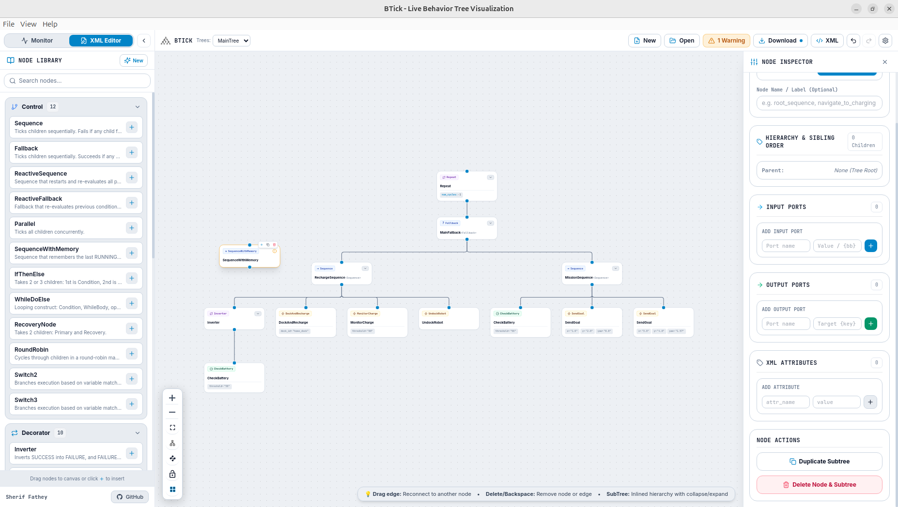

=====================
XML Editor User Guide
=====================

The BTick application includes an integrated **Behavior Tree Editor** that allows you to author, modify, and validate BehaviorTree.CPP v4 XML files directly in your web browser.

..
   .. figure:: _static/images/tree_editor_visual.png
      :alt: Visual Tree Editor
      :align: center
   
      BTick Visual Tree Editor showing the node palette, canvas, and property inspector.

Accessing the Editor
====================

To switch from live monitoring to the editor, click the **XML Editor** mode button in the top navigation bar. You can return to live monitoring at any time by clicking **Monitor**.

Opening & Creating Behavior Tree XML Files
==========================================

Creating a New Tree
-------------------
Click **New Tree** on the editor toolbar to create a default BehaviorTree.CPP v4 XML document. The document contains a `root` element, a `BehaviorTree` definition, and a default `Sequence` node.

.. code-block:: xml

   <root BTCPP_format="4" main_tree_to_execute="MainTree">
     <BehaviorTree ID="MainTree">
       <Sequence name="root_sequence">
         <!-- Child nodes will be placed here -->
       </Sequence>
     </BehaviorTree>
   </root>

Opening an Existing XML File
----------------------------
Click Open XML on the toolbar to select and upload an existing BehaviorTree.CPP XML file from your local computer. BTick parses the XML and displays the supported tree structure on the canvas.

Editing the Tree Structure
==========================

The Node Palette
-------------------------
The left sidebar provides the available BehaviorTree.CPP v4 node types, organized by category:

- **Control Nodes** (⑂): `Sequence`, `Fallback`, `ReactiveSequence`, `ReactiveFallback`, `Parallel`.
- **Decorator Nodes** (🔁): `Inverter`, `Repeat`, `RetryUntilSuccessful`, `ForceSuccess`, `ForceFailure`.
- **Action Nodes** (⚡): Execution nodes, including custom nodes such as `NavigateToPose` and `ComputePath`.
- **Condition Nodes** (⚙): Nodes that evaluate conditions, including custom nodes such as `IsBatteryLow` and `IsGoalReached`.
- **SubTrees** (🗂): References to reusable subtrees by ID.

Adding & Connecting Nodes
-------------------------
1. **Drag and Drop**: Drag any node primitive from the palette and drop it onto the canvas.
2. **Connecting Nodes**: Drag a connection wire from the bottom output handle of a parent Control or Decorator node to the top input handle of a child node.
3. **Reordering Children**: For Control nodes such as `Sequence` and `Fallback`, child order determines execution order. To change the order, select the parent node on the canvas to open the **Node Inspector**, then locate **Children Execution Order**. Click the child node's name and move it **up or down** to change its execution order.
4. **Deleting Nodes**: Select a node card and press ``Delete`` or ``Backspace`` (or click the delete icon in the inspector).

Configuring Node Properties & Ports
===================================

Selecting any node on the canvas opens the **Node Inspector** on the right side:

* **Node Name / ID**: Edit the descriptive instance name and the registered C++ class type ID.
* **Port Bindings**:

  * **Literal Values**: Enter constants directly (e.g. ``timeout="10.0"``).
  * **Blackboard Keys**: Enclose key names in curly braces (e.g. ``goal="{target_pose}"``) to bind the port dynamically to shared Blackboard memory.

Validation & Error Handling
===========================

Click **Validate** on the toolbar to run tree structural checks:

.. list-table::
   :widths: 30 70
   :header-rows: 1

   * - Validation Check
     - Description
   * - **Single Root Node**
     - Verifies that the tree has exactly one top-level root node under ``<BehaviorTree>``.
   * - **Decorator Child Limit**
     - Ensures that Decorator nodes have exactly one child node.
   * - **Dangling Connections**
     - Flags nodes that are disconnected from the root execution path.
   * - **Required Attributes**
     - Checks that all nodes have valid ``ID`` attributes and non-empty names.

If validation issues are found, BTick presents a checklist highlighting the exact nodes that require correction.

.. note:: 
  Validation checks the structural constraints supported by the editor. Passing validation does not guarantee successful execution at runtime, as custom node registration, port compatibility, and runtime dependencies must also be verified.

Raw XML Mode
============

To inspect or edit the underlying XML directly, click the **XML View** button in the toolbar:

..
   .. figure:: _static/images/tree_editor_xml.png
      :alt: XML Tree Editor
      :align: center
   
      Raw XML editor modal showing syntax-highlighted code and live synchronization.

* **Two-Way Synchronization**: Any edits made in the raw text view immediately update the graphical canvas when you click **Apply Changes**.
* **Direct Copy**: You can copy the generated XML directly to your clipboard for use in robot packages.

Saving & Exporting Files
========================

Click **Save XML** on the toolbar to download the validated BehaviorTree.CPP XML file to your computer.

